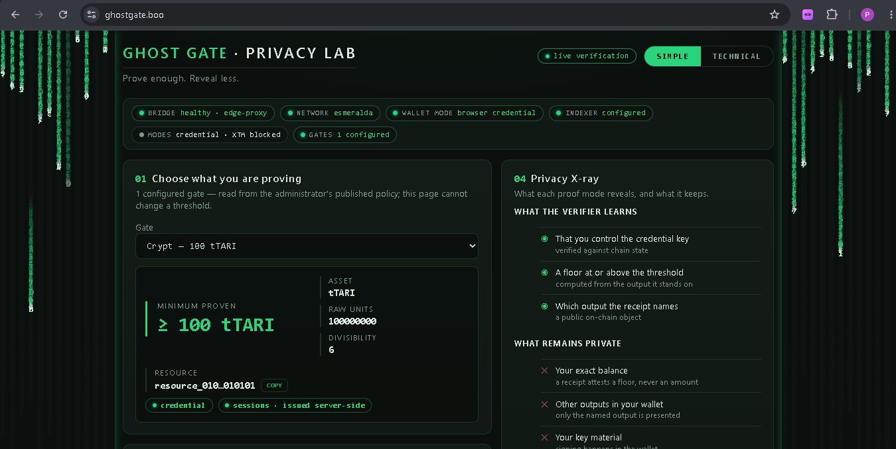
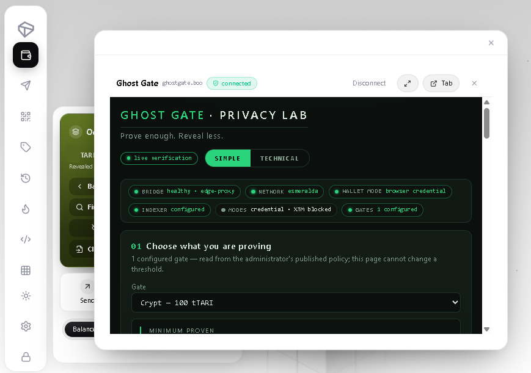
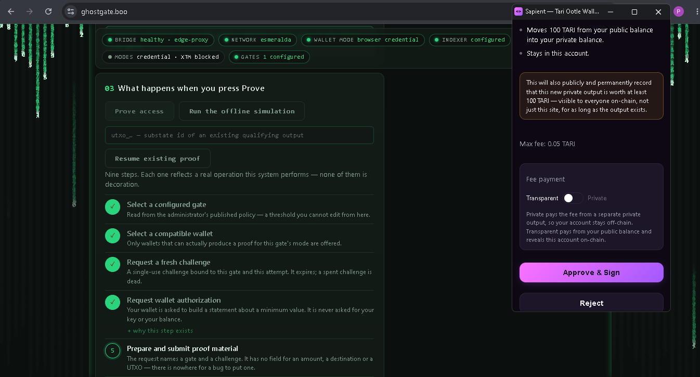
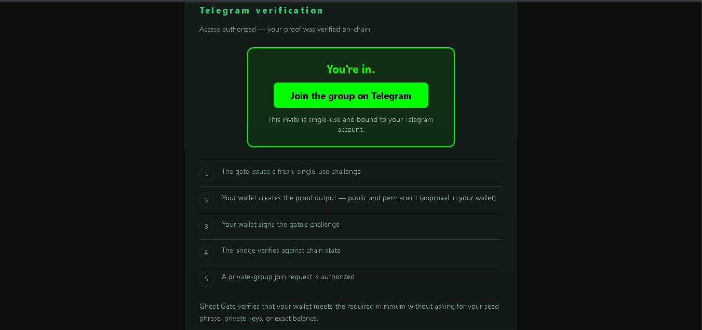
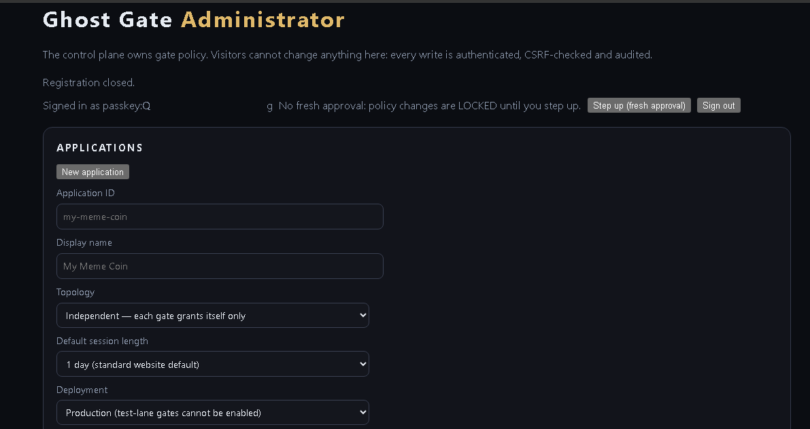
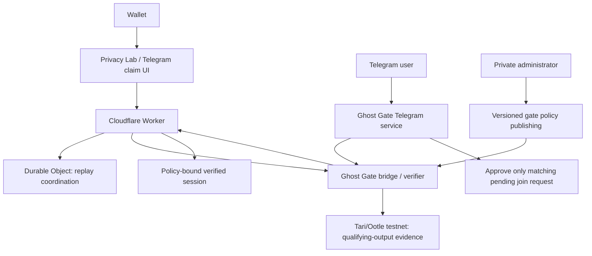
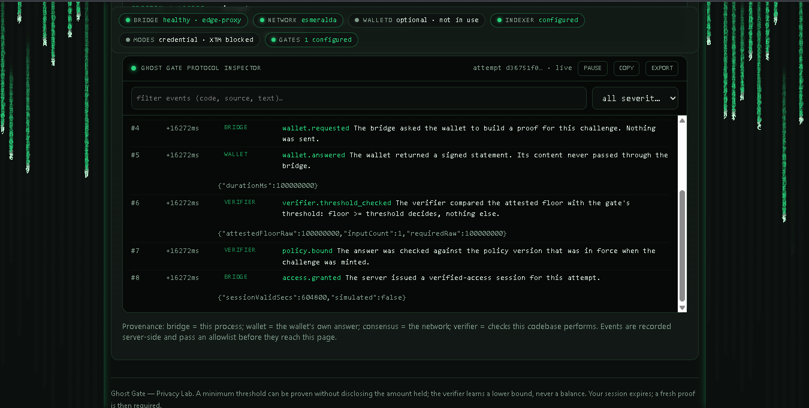
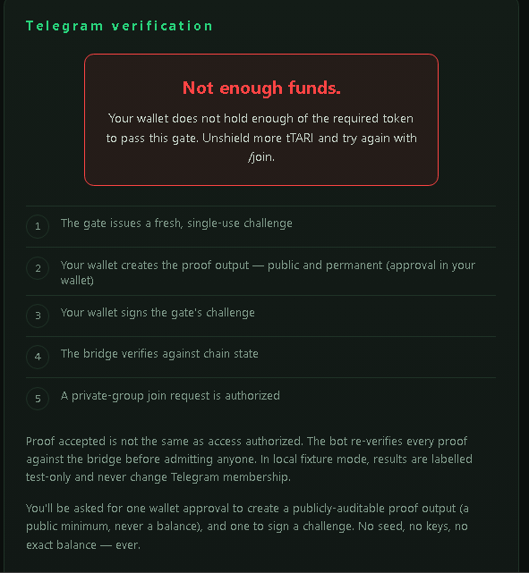

# Ghost Gate

**Privacy-aware access control for Tari.**

## Prove enough. Reveal less.

Ghost Gate lets an application answer a narrow question—does this visitor meet this policy?—without
asking for a seed phrase, private key, wallet screenshot, video, or exact total balance. Privacy Lab
is the public demonstration surface at [ghostgate.boo](https://ghostgate.boo); **Ghost Gate** is the
underlying access-control technology.



> **Current status:** a working, fail-closed, operator-trusted Esmeralda testnet demonstration.
> It is not production authorization infrastructure and does not yet provide fully confidential
> aggregate-balance proofs.

## Contest Judge Path

| | |
| --- | --- |
| **Live demo** | [ghostgate.boo](https://ghostgate.boo) |
| **Telegram bot** | `@GhostGateGSXRBot` |
| **Current test gate** | Crypt — 100 tTARI — Esmeralda testnet |
| **Demonstrated wallet surfaces** | Sapient; Web Tari Universe embedded dApp |
| **Short walkthrough** | [docs/DEMO.md](docs/DEMO.md) |

The live Crypt v3 policy is credential-based, requires wallet approval, and issues a seven-day
verified session after a successful check.

## Why Ghost Gate Exists

Ghost Gate began with a familiar but uncomfortable access pattern: a community asked prospective
members to submit a **video showing their token balance** before a moderator would admit them.

That process reveals far more financial information than the community needs. It can expose balances
visually, create screenshots or videos that can be stored and forwarded, require inconsistent manual
review, offer weak freshness or replay guarantees, and make human moderators custodians of data they
should never need to see.

Ghost Gate is designed around a simpler question:

> Can a user prove they meet the requirement without showing everything they own?

If a community only needs a yes/no answer for a 100 tTARI policy, it should not need to know that a
member holds 37,842 tTARI. The primitive is **policy-bound proof → authorization decision**;
Telegram is one demonstrated integration, not the product's limit.

## What Works Today

The live Crypt demonstration verifies a qualifying **native tTARI** output against this fixed,
published policy:

| Field | Value |
| --- | --- |
| Network | Esmeralda testnet (`38`) |
| Gate | Crypt |
| Threshold | 100 tTARI (`100000000` raw) |
| Policy version | v3 |
| Proof mode | Credential |
| Policy hash | `13af3169aefb313f355368c5b9131d512d86048ab700d850024c79ddb680b74f` |
| Verified-session lifetime | 7 days |

A successful result checks a lower bound. Ghost Gate does **not** request a seed phrase, private
key, exact total wallet balance, or an amount-above-threshold field from the user. The current Crypt
flow does use a qualifying **revealed/public tTARI output**. It must not be described as a fully
confidential aggregate wallet-balance proof; relevant qualifying-output and transaction metadata can
be observable even though the application does not need the user's total holdings.

## Privacy Lab: the Public Proof and Inspection Surface

Privacy Lab is the public-facing demonstration UI, not a rename for Ghost Gate. It demonstrates
wallet connection, published-gate selection, the challenge/proof lifecycle, Simple and Technical
views, threshold/session state, and Telegram onboarding. It shows both successful and refused paths:
insufficient qualifying funds are rejected rather than turned into client-side success text.

## Demonstrated Wallet and Access Surfaces

| Surface | Demonstrated today |
| --- | --- |
| **Sapient** | Wallet connection, Crypt challenge/proof, insufficient-funds rejection, successful threshold verification, live use, and Telegram claim flow |
| **Web Tari Universe** | Ghost Gate loads Tari's [official dApp connector](https://universe.tari.mw/integration/) inside the embedded browser; embedded wallet connection and Crypt proof succeed; `ACCESS GRANTED` is produced; external Telegram links safely leave the frame |
| **Telegram** | Account-bound onboarding, server-side re-verification, and automated approval of the matching pending join request |

These are demonstrated integrations, not a claim that every Tari wallet or every resource type is
already production-verified.





## Telegram: From Proof Page to Access Automation

```text
Telegram user
  → /join to @GhostGateGSXRBot
  → account-bound, single-use Ghost Gate link
  → supported wallet connects and completes Crypt proof
  → Ghost Gate verifies the policy
  → Telegram service re-checks authorization server-side
  → matching Telegram identity and pending join request are confirmed
  → bot approves that exact join request
```

The bot never receives a seed phrase or private key, does not need the user's exact total balance,
does not manually inspect screenshots/videos, and does not blindly trust browser text claiming
success. Wrong, expired, replayed, or identity-mismatched requests fail closed.



One internal user and one external user independently completed the Telegram-gated admission flow
during testing.

## Policy-Driven, Not Hardcoded to One Gate

Ghost Gate is architected around versioned policy and resource identifiers rather than one separate
technology per token. The policy model can represent different resources/assets, raw thresholds,
divisibility, networks, relying sites, applications, session durations, and integration/use modes.

That design can express a 10 tTARI developer group, a 100 tTARI community, a higher-value holder
group, a feature unlock, beta access, or a community role. **Crypt on native tTARI is the live
demonstrated policy.** Other assets, policies, and surfaces remain potential extensions until their
required wallet/proof primitives are separately demonstrated and reviewed.

The administrator view is separate from public proof pages and is where versioned policy is
managed.



## Where Ghost Gate Could Be Used

The reusable idea is selective-disclosure authorization, not Telegram itself. Potential applications
include private Telegram communities and future Discord/community integrations; token-gated web
applications, member portals, and premium features; private beta, developer, tester, and ecosystem
access; DAO/community roles; high-value holder communities and events; and API, resource, tool,
download, or gated-content access. These are product directions, not claims that every integration
or asset policy is deployed today.

## Architecture and Trust Boundaries



The public UI cannot mutate policy. The private administrator plane is separate. The Worker and
verifier are separate trust domains; a Cloudflare Tunnel provides restricted bridge ingress. The
Worker coordinates replay-sensitive state when configured, while the bridge verifies the
policy-bound credential. See [architecture](docs/ARCHITECTURE.md).

## Protocol Inspector / Technical Verification

The Technical view exposes a sanitized verification trace for the current proof flow so the
demonstration can be inspected without exposing a wallet's exact total balance.



## Security and Privacy Design

Ghost Gate fails closed because an authorization system should prefer a clear refusal to an
unverifiable grant.

When proof evidence does not satisfy the published policy, Privacy Lab returns a refusal instead
of granting access.



| Control | Practical reason |
| --- | --- |
| Fresh challenge and wallet proof | An old response should not act like a permanent membership coupon. |
| Relying-site binding | A proof minted for one site should not simply be reusable by another. |
| Gate, policy hash, and version binding | The verifier checks published policy, not a browser-selected threshold. |
| Session commitment and expiry | Access is time-bounded and bound to the authorization lifecycle. |
| Replay coordination | Captured or concurrent proof attempts cannot create unlimited sessions. |
| Origin restrictions and authenticated Worker/bridge contract | Browser-controlled routing does not become verifier authority. |
| Server-side Telegram re-verification | The bot does not trust a browser saying “success.” |
| Telegram user/chat binding and single-use links | A result cannot be casually transferred to another account or group request. |
| Private administrator plane | Public visitors cannot mutate gate policy. |

The current trust model remains **operator-trusted testnet**. It is not a claim of production
consensus-verified authorization, anonymity, perpetual eligibility, or fully confidential balance
proof. See [security model](docs/SECURITY.md).

## Testing and Real-World Validation

### Automated

- Worker route, origin, catalog, replay, credential-body transport, Telegram join-config, and UI
  security tests: **53 passed; 1 integration test intentionally skipped** in the release check.
- Browser-provider capability and proof-flow tests: **31 passed** in the release check.
- A clean clone repeated the locked Worker install/tests and browser-provider suite successfully.
- The Rust workspace suite status is recorded in the [final public-release audit](docs/FINAL_PUBLIC_RELEASE_AUDIT.md); the current
  Windows release environment is blocked before Rust tests start by a missing compatible Visual
  Studio/CMake toolchain for `randomx-rs`. No test was changed or bypassed.

### Live End-to-End

Release evidence also includes insufficient tTARI rejection, qualifying-threshold acceptance, Crypt
session issuance, Sapient use, Web Tari Universe proof, and Telegram admission—including an
independently completed external admission result. These outcomes are testnet demonstration
evidence, not a production claim.

## XTM / Minotari L1 Research Direction

Ghost Gate is investigating whether privacy-preserving minimum-balance proofs can be made available
for Minotari L1 XTM. Relevant work includes L1 wallet ownership challenges, experimental GGBP-1
minimum-balance-proof work, chain-state verification, reusable wallet-core proof-protocol research,
and browser/WASM or mobile/desktop integration paths.

This could extend selective-disclosure access to mainnet-native Tari holdings rather than only
Ootle/testnet resources. It is **active research**, not a completed Ghost Gate XTM feature. No
mainstream XTM wallet is claimed to provide the finished private threshold proof today.

## The Longer-Term Privacy Goal

Today, Crypt uses a qualifying revealed/public output. The natural next step is to prove control of
sufficient confidential value without revealing or unshielding the qualifying balance/output. That
is the direction toward stronger confidential threshold proofs—not a capability this release claims.

## Known Limitations and Roadmap

- Current Crypt v3 uses a revealed/public qualifying native tTARI output.
- Telegram grant state is process-memory state and is not persistent across restart.
- The demonstrated trust model is operator-trusted testnet.
- Fully confidential threshold proofs, persistent grants, self-service gate/group onboarding,
  production trust/bootstrap hardening, and additional assets/policies are future work.

## Running Locally

The Rust workspace is pinned to a patched Tari Ootle v0.42.0 source cohort. From a fresh checkout,
prepare that required sibling directory first:

```powershell
git clone https://github.com/tari-project/tari-ootle.git ..\_ootle-v042-ghost-gate
git -C ..\_ootle-v042-ghost-gate checkout a43773e600b9503ed3fadcd3f0048f86131e3644
git -C ..\_ootle-v042-ghost-gate apply "$PWD\docs\wallet-mvp.patch"

cargo test --workspace

Set-Location cloudflare
npm ci
npm test
Set-Location ..
node --test web/js/ghost/test.js
```

A full local Crypt demonstration additionally requires separately provisioned testnet infrastructure
and operator-managed secrets; none are included here. Deployment templates contain placeholders:
see [`deploy/README.md`](deploy/README.md).

## Release and Contest Materials

- [Two-minute demo walkthrough](docs/DEMO.md)
- [Architecture](docs/ARCHITECTURE.md)
- [Security model](docs/SECURITY.md)
- [Telegram integration](docs/TELEGRAM.md)
- [Contest submission draft](docs/CONTEST_SUBMISSION_DRAFT.md)
- [Final public-release audit](docs/FINAL_PUBLIC_RELEASE_AUDIT.md)
- [Historical notes](docs/HISTORICAL_NOTES.md)

## License

MIT. See [LICENSE](LICENSE). Tari Ootle and its dependencies retain their respective licenses.
