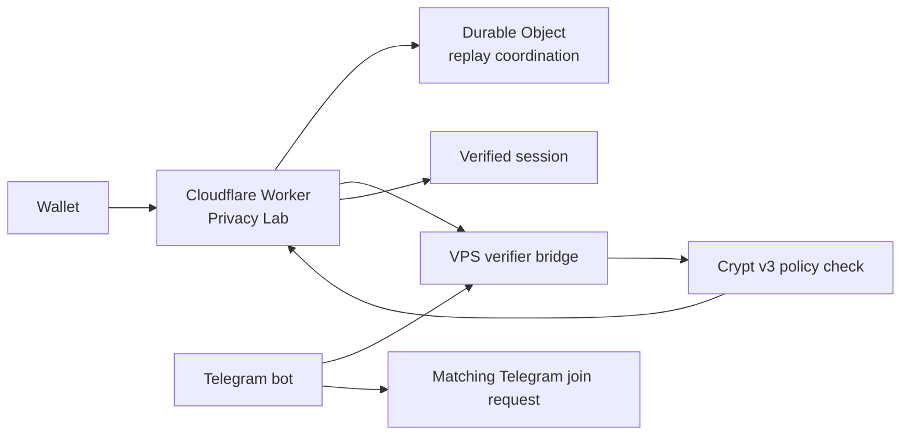

# Ghost Gate

Privacy-aware access control for Tari. **Prove enough. Reveal less.**

Ghost Gate lets a relying site check that a visitor meets a minimum tTARI threshold without asking
for a seed phrase, private key, or exact wallet balance. The public demonstration is **Privacy Lab**
at [ghostgate.boo](https://ghostgate.boo); Ghost Gate is the underlying gating technology.

> **Status:** Crypt v3 is a live, operator-trusted Esmeralda testnet demonstration. It is
> fail-closed, but it is not production consensus-verified authorization infrastructure.

## What Ghost Gate Does

The current Crypt policy checks a 100 tTARI floor. A successful result demonstrates that the user
presented a qualifying output for the policy, without disclosing their total wallet balance or the
amount above the required floor.

The current browser flow is credential-based. It uses a qualifying **revealed/public tTARI output**;
fully confidential minimum-balance proofs that avoid revealing or unshielding such an output remain
future work. Do not describe the current Crypt v3 flow as a fully confidential balance proof.

## Live Demo

Visit [ghostgate.boo](https://ghostgate.boo) to use Privacy Lab.

- Privacy Lab provides simple and technical views of the gate decision.
- Sapient is a tested wallet integration.
- Web Tari Universe embedding and wallet connection are tested integrations.
- The Telegram bot supports account-bound onboarding and gated join approval.

The active Crypt v3 demo policy is:

| Field | Value |
| --- | --- |
| Network | Esmeralda testnet (`38`) |
| Threshold | 100 tTARI (`100000000` raw) |
| Proof mode | Credential |
| Policy version | v3 |
| Policy hash | `13af3169aefb313f355368c5b9131d512d86048ab700d850024c79ddb680b74f` |
| Verified-session lifetime | 7 days |

## How It Works

```text
wallet → challenge → qualifying output proof → verifier → policy threshold check → session/access decision
```

For Telegram, the bot issues an account-bound, single-use link after `/join`. Ghost Gate verifies
the proof server-side, then the bot approves only the matching pending Telegram join request.

## Privacy Properties

- Ghost Gate never requests a seed phrase or private key.
- The Ghost Gate result does not disclose the exact wallet balance.
- The verifier learns the policy's required lower bound, not the amount above it.
- The current Crypt implementation relies on a revealed/public qualifying tTARI output.
- Testnet activity and normal transaction metadata remain observable; this is not an anonymity claim.

See [docs/SECURITY.md](docs/SECURITY.md) for the security and trust model.

## Supported Integrations

| Integration | Release status |
| --- | --- |
| Sapient | Tested in the live demo |
| Web Tari Universe | Tested embedded-dapp integration |
| Telegram (`@GhostGateGSXRBot`) | Tested onboarding and server-side gated approval |
| Other wallet/provider paths | Experimental unless separately documented |

## Architecture



The Worker hosts Privacy Lab and coordinates challenge replay state. A VPS bridge verifies the
credential against the published policy. The private administrator plane is separate from the
public application. A Cloudflare Tunnel provides restricted ingress to the bridge. More detail:
[architecture](docs/ARCHITECTURE.md) and [Telegram flow](docs/TELEGRAM.md).

## Security Model

Ghost Gate is designed to fail closed. It binds proof processing to the relying-site origin, policy
version/hash, challenge nonce, and session commitment. The Worker/bridge contract is authenticated;
replay coordination is handled by a Durable Object when configured. Telegram admission performs a
server-side re-verification and only approves the account that requested the matching join.

This release is **operator-trusted testnet** technology. It is not a production consensus-verifiable
authorization system, and it must not be represented as one.

## Running Locally

The Rust workspace is pinned to a patched Tari Ootle v0.42.0 source cohort. Before running Rust
commands in a fresh checkout, prepare that sibling directory from the pinned public source:

```powershell
# Run from the Ghost Gate repository root. The resulting sibling is required by Cargo.toml.
git clone https://github.com/tari-project/tari-ootle.git ..\_ootle-v042-ghost-gate
git -C ..\_ootle-v042-ghost-gate checkout a43773e600b9503ed3fadcd3f0048f86131e3644
git -C ..\_ootle-v042-ghost-gate apply "$PWD\docs\wallet-mvp.patch"
```

A full local Crypt demonstration additionally requires separately provisioned testnet
infrastructure and operator-managed secrets; none are included in this repository.

```powershell
# Rust workspace tests
cargo test --workspace

# Cloudflare Worker tests
Set-Location cloudflare
npm ci
npm test
Set-Location ..
```

Deployment environment templates are in [`deploy/`](deploy/README.md). Keep actual deployment
configuration and secrets outside Git; the templates use placeholders only.

## Testing

Run the commands above plus the focused browser-provider suite when changing the browser adapter:

```powershell
node --test web/js/ghost/test.js
```

Test counts are intentionally not hard-coded here. The release-readiness record identifies the
commands and their results for this candidate.

## Deployment

The public Worker, private verifier bridge, Telegram service, and private administrator plane are
deployed as separate trust domains. Configure Worker secrets through the deployment platform and
service secrets through the host's secret-management process; do not place them in Wrangler files,
source files, screenshots, or shell history. See [`deploy/README.md`](deploy/README.md).

## Known Limitations

- Crypt v3 uses a revealed/public qualifying output.
- Telegram grant state is process-memory state and is not persistent across process restart.
- The demo is testnet and operator-trusted.
- Fully confidential minimum-balance proofs are future work.

## Roadmap

- Fully confidential minimum-balance proofs.
- Persistent Telegram grant state.
- Self-service gate creation and Telegram group onboarding.
- Production trust/bootstrap hardening.
- Additional assets and policies.

These are roadmap items, not completed features.

## Release Documentation

- [Demo walkthrough](docs/DEMO.md)
- [Architecture](docs/ARCHITECTURE.md)
- [Security model](docs/SECURITY.md)
- [Telegram integration](docs/TELEGRAM.md)
- [Release readiness](RELEASE_READINESS.md)
- [Historical notes](docs/HISTORICAL_NOTES.md)

## License

MIT. See [LICENSE](LICENSE). Tari Ootle and its dependencies retain their respective licenses.
