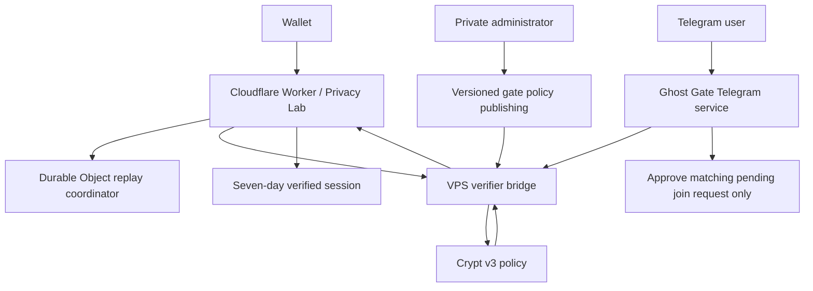

# Architecture

Ghost Gate separates public presentation, policy verification, and administration.

## Components

- **Privacy Lab:** the public interface at `https://ghostgate.boo`.
- **Cloudflare Worker:** serves the static interface and handles public request routing.
- **Durable Object:** coordinates a challenge nonce's replay-sensitive lifecycle when configured.
- **VPS verifier bridge:** validates the submitted credential against the active gate policy and
  returns a signed result to the Worker.
- **Telegram service:** creates account-bound join links, re-verifies server-side, and approves
  only a matching pending join request.
- **Private administrator plane:** manages policy/admin concerns independently of public traffic.
- **Cloudflare Tunnel:** provides restricted ingress to the verifier bridge rather than exposing
  its loopback listener directly.

The resulting primitive is policy-bound proof followed by an authorization decision. Privacy Lab
and Telegram are demonstrated surfaces for it; future applications can use the same policy model
without treating a browser UI or a chat bot as the authority.

## Active Crypt policy

Crypt v3 is bound to `https://ghostgate.boo`, Esmeralda testnet network `38`, the 100 tTARI raw
floor `100000000`, credential proof mode, and policy hash
`13af3169aefb313f355368c5b9131d512d86048ab700d850024c79ddb680b74f`.

This is a testnet, operator-trusted flow. The credential is based on a revealed/public qualifying
tTARI output, not a fully confidential balance proof.
